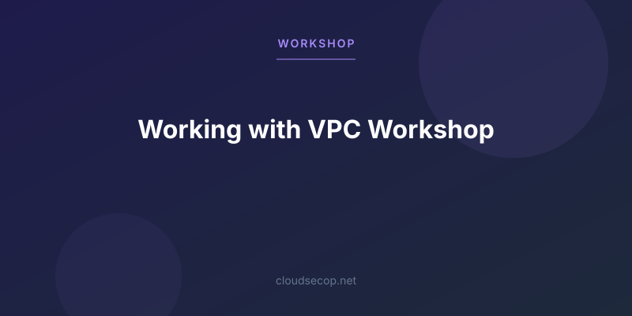

# Blog Assets

Cover images for the projects, workshops and posts published by [Van Hoang Kha](https://github.com/vanhoangkha), including the AWS First Cloud Journey workshop series.

## Contents

The repository contains 332 SVG cover images in the root folder. Each file is named after the repository or post it illustrates, for example:

| File | Used for |
| --- | --- |
| `000003-WorkingwithVPC.svg` | The [000003-WorkingwithVPC](https://github.com/vanhoangkha/000003-WorkingwithVPC) workshop |
| `AWS-First-Cloud-Journey.svg` | The [aws-first-cloud-journey](https://github.com/vanhoangkha/aws-first-cloud-journey) project |

## Usage

Reference an image by its raw URL:

```markdown

```

## Adding an image

1. Export the cover as an SVG.
2. Name it after the repository or post slug it belongs to.
3. Add it to the repository root and open a pull request.
